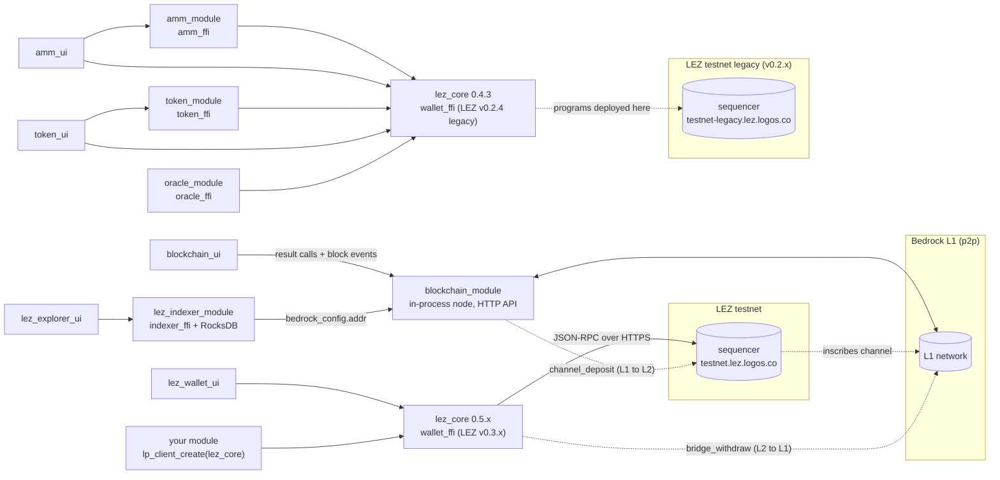

# Stack: Logos Blockchain (Bedrock L1) + Logos Execution Zone (LEZ L2)

**Pinned at:** Basecamp 0.3.2 (`f2fae63`); amm_module 0.3.0 (`543563a`), amm_ui 0.3.0 (`543563a`), blockchain_module 0.3.4 (`b1eed59`), blockchain_ui 0.3.5 (`df4fea7`), lez_core 0.5.1 (`51a6fee`), lez_explorer_ui 1.2.3 (`72039dd`), lez_indexer_module 1.2.1 (`87463b1`), lez_wallet_ui 1.2.2 (`486379e`), logos_execution_zone 1.0.0 (`01ceef1`), oracle_module 0.1.0 (`543563a`), token_module 0.1.0 (`543563a`), token_ui 0.1.0 (`543563a`).

Twelve catalog packages from the `logos-blockchain` org, as shipped in the default catalog
`logos-co/logos-modules-release` (index 2026-11-04). Since the 2026-10-14 revision of this page
the DEX moved to a new source and two new families arrived; `blockchain_module` 0.3.4 changed its
contract and `lez_core` now has **two consumers with incompatible ranges** (see [The LEZ split](#the-lez-split-lez_core-043-vs-05x)).
Three independent chains of modules sit here; they share no process state and talk to different networks:

1. **L1 node** — `blockchain_module` runs a full Bedrock node in-process; `blockchain_ui` drives it.
2. **LEZ wallet** — `lez_core` wraps the Rust `wallet_ffi` and talks HTTPS to a LEZ *sequencer*
   (default `https://testnet.lez.logos.co`). `lez_wallet_ui` calls it on the 0.5.x line; `amm_module`, `amm_ui`,
   `token_module`, `token_ui` and `oracle_module` call it on the legacy `0.4.3` line. No one `lez_core`
   version satisfies both groups' ranges (see [the split](#the-lez-split-lez_core-043-vs-05x)).
3. **LEZ read side** — `lez_indexer_module` indexes a LEZ channel by reading an L1 node's HTTP API;
   `lez_explorer_ui` browses it.

`logos_execution_zone` 1.0.0 is in the index but is an accidental re-release of the pre-rename
`lez_core` from June 2026. Do not use it (see [§logos_execution_zone](#logos_execution_zone-superseded)).

Source read at the commits pinned by the catalog (`data/catalog-pins.tsv`); the AMM, token and oracle
wrappers were followed to `logos-blockchain/lez-programs@543563a` (the AMM was `fb76bec` on 2026-10-14), and `lez_core`'s Rust library to
`logos-blockchain/logos-execution-zone@1a003bf` (tag `v0.3.1`). The legacy `lez_core` 0.4.3 was read at
`logos-blockchain/logos-execution-zone-module@e02937c` (its `lez-0.2.4` wallet-ffi is LEZ `80a648a`). The `lez_core` contract below was checked against
`nix build github:logos-blockchain/logos-execution-zone-module/51a6fee#lidl`.

## Modules

| module | type | role | holds keys? | depends on (manifest) | catalog version |
|---|---|---|---|---|---|
| `blockchain_module` | core | Bedrock L1 node + node wallet, PoW, channel deposits | **yes**: node `keystore.yaml` (ed25519 + zk) | — | 0.3.4 |
| `blockchain_ui` | ui_qml | node onboarding, dashboard, wallet, mining, rewards, LEZ channel deposit | no (drives the module; can copy the keystore) | `blockchain_module` (no range; was `>=0.3.0`) | 0.3.5 |
| `lez_core` | core | LEZ wallet: accounts, transfers, generic/private txs, program deploy, bridge withdraw | **yes**: BIP39-derived key tree in `storage.json` | — | 0.5.1 |
| `lez_wallet_ui` | ui_qml | LEZ wallet app (onboarding, accounts, 6 transfer rails, withdraw) | no (mnemonic shown once) | `lez_core >=0.5.1` | 1.2.2 |
| `lez_indexer_module` | core | LEZ channel indexer (RocksDB), JSON query API | no | — | 1.2.1 |
| `lez_explorer_ui` | ui_qml | LEZ block explorer | no | `lez_indexer_module >=1.2.0` | 1.2.3 |
| `amm_module` | core | Logos DEX logic (quotes, swaps, liquidity, admin) over `lez_core` | no (signs via `lez_core`) | `lez_core` **exactly `0.4.3`** | 0.3.0 |
| `amm_ui` | ui_qml | Logos DEX app | no | `lez_core` exactly `0.4.3`, `amm_module` | 0.3.0 |
| `token_module` | core | LEZ Token Program: inspect definitions/holdings, create, transfer, mint, burn, NFT print | no (signs via `lez_core`) | `lez_core` exactly `0.4.3` | 0.1.0 |
| `token_ui` | ui_qml | Token app: create and inspect Token Program assets, with its own wallet onboarding | no (mnemonic shown once) | `lez_core` exactly `0.4.3`, `token_module` | 0.1.0 |
| `oracle_module` | core | TWAP oracle feeds: create and update price accounts, record ticks, publish prices | no (signs via `lez_core`) | `lez_core` exactly `0.4.3` | 0.1.0 |
| `logos_execution_zone` | core | **superseded** old name of `lez_core` | yes | — | 1.0.0 (linux only) |

Variants: every package above ships `darwin-arm64`, `linux-amd64`, `linux-arm64`; none ships
`windows-x86_64`; `logos_execution_zone` ships linux only. Note the two dependency spellings in
manifests: objects (`{"name","version"}`) and bare strings (`blockchain_ui`'s `blockchain_module`, `amm_ui`'s and
`token_ui`'s `amm_module` / `token_module`, mixed with an object for `lez_core`) — both are valid LGX. A bare string is an unranged dependency.

## How it fits together

Two `lez_core` boxes are drawn because the catalog's manifests demand two different versions, and the dependency gate checks against one installed `lez_core` (see below). The legacy sequencer edge is from the programs' deployment record, not
from `lez_core`'s defaults, which still name `testnet.lez.logos.co`.

---

## The LEZ split: `lez_core` 0.4.3 vs 0.5.x

**The catalog now ships two groups of LEZ modules whose `lez_core` ranges no single installed version satisfies.** Read from the manifests and the dependency gate; the runtime outcome is **unverified** (below).

| group | modules | declares `lez_core` | LEZ line it links |
|---|---|---|---|
| wallet | `lez_wallet_ui` 1.2.2 | `>=0.5.1` | LEZ **v0.3.x** (`lez_core` 0.5.1 links `v0.3.1`) |
| programs | `amm_module` 0.3.0, `amm_ui` 0.3.0, `token_module` 0.1.0, `token_ui` 0.1.0, `oracle_module` 0.1.0 | exactly `"0.4.3"` | LEZ **v0.2.x legacy** (`lez_core` 0.4.3 links LEZ `80a648a`, the v0.2.4 wallet-ffi) |

- **The catalog offers** `lez_core` 0.4.0, 0.4.1, 0.4.2, 0.4.3, 0.5.0 and 0.5.1. 0.4.3 was published on
  2026-10-16, four days *after* 0.5.1 (2026-10-12), from `logos-execution-zone-module` branch `release/lez-0.2.4`
  ([e02937c](https://github.com/logos-blockchain/logos-execution-zone-module/commit/e02937cc9248dabc684c3b1d7daaa8431be27bff),
  "bump LEZ to the 0.2.4 wallet fix and release as 0.4.3"). The catalog's "latest" is still 0.5.1.
- **Why the programs group is pinned.** The five packages are wrappers over `lez-programs@543563a`, whose
  `flake.nix` pins `lez_core` to the 0.4.3 release (`673d115`, "branch `release/lez-0.2.4`") and calls it
  the "LEZ v0.2.4 legacy wallet-ffi" ([flake.nix#L38-L59](https://github.com/logos-blockchain/lez-programs/blob/543563af88b5638e308a981106fd821690227011/flake.nix#L38-L59)).
  Its reason is that the legacy wallet-ffi's storage, config schema and RPC match the deployed legacy sequencer and the
  guests that are already on chain, and that the 4-argument `send_generic_public_transaction` needs no Borsh migration.
  The wrapper commits say the same ("pin lez-programs to lez-v0.2.x … (lez_core 0.4.3)", e.g.
  [logos-amm-module@81b485c](https://github.com/logos-blockchain/logos-amm-module/commit/81b485c)).
- **The ABIs differ, so a loose range would not save you.** `lez_core` 0.4.3 has `create_new(config, storage, statistics, password)`,
  `open(config, storage, statistics)`, a **4**-argument `send_generic_public_transaction` and the built-in `token_elf()` / `amm_elf()`
  ([lez_core_module.h#L33-L34, L76-L78, L85](https://github.com/logos-blockchain/logos-execution-zone-module/blob/e02937cc9248dabc684c3b1d7daaa8431be27bff/src/lez_core_module.h#L33-L85)).
  0.5.1 takes two/three/**6** and has no `*_elf()` (see [Version drift](#using-lez_core-from-another-module)).
- **The gate.** liblogos refuses to load a module whose installed dependency does not satisfy its declared range
  ([guides/calling-official-modules.md §1](../guides/calling-official-modules.md)). `lez_wallet_ui` needs `>=0.5.1` and the five others need
  `0.4.3`, so no single installed `lez_core` satisfies both groups. Whether Basecamp's Package Manager installs both
  `lez_core` versions side by side, refuses the second install, or replaces the first is **unverified**: nothing was installed or loaded to find out.
  How liblogos reads a bare `0.4.3` (as an exact version) is also **unverified**.
- **Relation to the LEZ testnet reset.** The two lines are the two LEZ releases made around the reset: LEZ v0.3.1 (2026-10-11; its notes list the removed
  L2 signing key, "existing sequencer configs and homes need updating", and a `logos-blockchain` bump) and
  v0.2.4-lez-legacy (2026-10-13, v0.2.4 rebuilt against logos-blockchain 0.3.1)
  ([releases](https://github.com/logos-blockchain/logos-execution-zone/releases)). That these two releases *are* the reset is not stated in those notes: **unverified**. The programs' deployment record lists a separate
  sequencer for the legacy line, `https://testnet-legacy.lez.logos.co/`, with the token, AMM, `twap_oracle` and `token_mint_authority` programs
  built from tag `v2.0.1` ([DEPLOYMENTS.md#L5-L21](https://github.com/logos-blockchain/lez-programs/blob/543563af88b5638e308a981106fd821690227011/DEPLOYMENTS.md#L5-L21)),
  and its runbook tells you to point the wallet's `sequencers` list there
  ([docs/testnet-runbook.md#L58-L64](https://github.com/logos-blockchain/lez-programs/blob/543563af88b5638e308a981106fd821690227011/docs/testnet-runbook.md#L58-L64)).
  The legacy wallet's default config still names `https://testnet.lez.logos.co` ([config.rs#L78-L88](https://github.com/logos-blockchain/logos-execution-zone/blob/80a648a155e524cf869b62778871b95cd6ac36a3/lez/wallet/src/config.rs#L78-L88)),
  so a fresh `token_ui` or `amm_ui` wallet that nobody edits would talk to the new testnet. Whether those programs exist on
  `testnet.lez.logos.co` is **unverified**: only the legacy deployment is recorded.
- **Upstream has moved on.** LEZ v0.3.2 (2026-10-29) states that `lez_core` 0.5.1 and `lez_wallet_ui` 1.2.2 "stay correct" against it, and v0.4.0-rc1 appeared the same day;
  the catalog has no `lez_core` newer than 0.5.1.

What to do: if you depend on `lez_core` yourself, choose a line and pin to it (`">=0.5.1"` for the wallet line, `"0.4.3"` to sit beside the DEX, token and oracle modules).
An unversioned dependency lands on the newest, 0.5.1, and then cannot coexist with the programs group.

---

## `lez_core` — the LEZ wallet module

Repo `logos-blockchain/logos-execution-zone-module@51a6fee`. A universal (Qt-free) C++ class,
`LEZCoreModule : LogosModuleContext`, over `wallet_ffi` from `logos-execution-zone` tag `v0.3.1`
(`1a003bf`, locked in `flake.lock`; 0.5.0 pinned rev `411adc8`, "0.3.0 + r0 linking fix") — [flake.nix#L13-L17](https://github.com/logos-blockchain/logos-execution-zone-module/blob/51a6fee385eedfdc65ba71f01447c5411a54bdf7/flake.nix#L13-L17).
API = [src/lez_core_module.h#L31-L125](https://github.com/logos-blockchain/logos-execution-zone-module/blob/51a6fee385eedfdc65ba71f01447c5411a54bdf7/src/lez_core_module.h#L31-L125).
No events. `metadata.json` declares `capabilities: []` and no `concurrency` key.

### The wallet model: one handle per process

`lez_core` holds a single `WalletHandle* walletHandle`
([h#L123-L124](https://github.com/logos-blockchain/logos-execution-zone-module/blob/51a6fee385eedfdc65ba71f01447c5411a54bdf7/src/lez_core_module.h#L123-L124)).
Basecamp loads each core module once, so **every caller in a session shares whichever wallet was
opened first** — the AMM README says so explicitly
([modules/amm/README.md#L73-L79](https://github.com/logos-blockchain/lez-programs/blob/543563af88b5638e308a981106fd821690227011/modules/amm/README.md#L73-L79)).
(That is per loaded `lez_core`; whether two versions can be loaded at once is **unverified**, see [the split](#the-lez-split-lez_core-043-vs-05x).)
There is no close/switch method. `open` and `create_new` refuse while a wallet is open
([cpp#L1185-L1235](https://github.com/logos-blockchain/logos-execution-zone-module/blob/51a6fee385eedfdc65ba71f01447c5411a54bdf7/src/lez_core_module.cpp#L1185-L1235)).

Known openers and where they put the wallet:

| opener | config / storage | source |
|---|---|---|
| `lez_wallet_ui` | `<wallet_dir()>/config.json`, `storage.json` (wallet_dir = `<session>/module_data/lez_core/<instance>/`; 1.2.0 also passed a `statistics.json` beside them, 1.2.2 does not); remembered in `QSettings("Logos","ExecutionZoneWalletUI")` and auto-opened at UI start | [LEZWalletBackend.cpp#L585-L634](https://github.com/logos-blockchain/logos-execution-zone-wallet-ui/blob/486379ec41ea0bd4e59cf3c82632429b0fed393b/src/LEZWalletBackend.cpp#L585-L634) |
| `amm_ui`, `token_ui` (same shared `WalletController` code) | `~/.lee/wallet/wallet_config.json`, `storage.json`, plus a `statistics.json` path that only the legacy `lez_core` 0.4.3 accepts (see [The LEZ split](#the-lez-split-lez_core-043-vs-05x)) (`LEE_WALLET_HOME_DIR` overrides). Both UIs therefore open the same files | [WalletController.cpp#L50-L61](https://github.com/logos-blockchain/lez-programs/blob/543563af88b5638e308a981106fd821690227011/apps/shared/wallet/src/WalletController.cpp#L50-L61) |
| any other caller | whatever paths it passes | — |

"Is a wallet already open?" idiom used by the AMM and token apps: `get_sequencer_addr()` non-empty, or
`list_accounts()` non-empty ([LogosWalletProvider.cpp#L329-L336](https://github.com/logos-blockchain/lez-programs/blob/543563af88b5638e308a981106fd821690227011/apps/shared/wallet/src/LogosWalletProvider.cpp#L329-L336)).

### Method surface (LIDL @ 51a6fee, version "0.5.1")

Lifecycle / config

| method | returns | notes |
|---|---|---|
| `wallet_dir()` | tstr | host persistence dir, or `"-"` when the host gave none ([cpp#L435-L439](https://github.com/logos-blockchain/logos-execution-zone-module/blob/51a6fee385eedfdc65ba71f01447c5411a54bdf7/src/lez_core_module.cpp#L435-L439)) |
| `create_new(config_path, storage_path, password)` | tstr | the **BIP39 mnemonic**, `""` on failure or if already open. Missing config file is written with the default (sequencer `https://testnet.lez.logos.co`) — [config.rs#L55-L69](https://github.com/logos-blockchain/logos-execution-zone/blob/1a003bfbfb89fcf987f62975cd08a401169e1b8c/lez/wallet/src/config.rs#L55-L69), [L78-L104](https://github.com/logos-blockchain/logos-execution-zone/blob/1a003bfbfb89fcf987f62975cd08a401169e1b8c/lez/wallet/src/config.rs#L78-L104). 0.5.0 took a `statistics_path` after `storage_path`; 0.5.1 dropped it |
| `open(config_path, storage_path)` | int | 0 ok; 99 (`InternalError`) if already open or open failed. No password. (0.5.0: three arguments, `statistics_path` last) |
| `save()` | int | writes `storage.json`. State is in memory until `save()` or a sync |
| `restore_storage(mnemonic, password, depth)` | int | `depth` is `uint` in 0.5.1. 0.5.0 typed it `any`, which the header warns is silently dropped over QtRO ([h#L80-L85](https://github.com/logos-blockchain/logos-execution-zone-module/blob/51a6fee385eedfdc65ba71f01447c5411a54bdf7/src/lez_core_module.h#L80-L85)), so it was likely unusable cross-process; whether it works now is unverified. What `depth` means is not documented in the module (unverified) |
| `get_sequencer_addr()` | tstr | `""` when no wallet is open |
| `name()` / `version()` | tstr | `version()` is a hard-coded literal: `"0.3.0"` in 0.5.0 (stale), `"0.5.1"` in 0.5.1 ([cpp#L425-L431](https://github.com/logos-blockchain/logos-execution-zone-module/blob/51a6fee385eedfdc65ba71f01447c5411a54bdf7/src/lez_core_module.cpp#L425-L431)); it matches `metadata.json` now but is bumped by hand, so do not use it for feature detection |

Accounts and reads

| method | returns |
|---|---|
| `create_account_public()` / `create_account_private()` | 64-hex account id, `""` on error |
| `list_accounts()` | `[{"account_id": hex32, "is_public": bool}]` |
| `get_balance(account_id_hex, is_public)` | decimal string of a u128 (lepta), `""` on error |
| `get_account_public(id)` / `get_account_private(id)` | JSON string `{"nonce": hex16, "shards": [{"program": hex32, "data": hex}]}` |
| `get_public_account_key(id)` | hex32 public key |
| `get_private_account_keys(id)` | `{"nullifier_public_key": hex32, "viewing_public_key": hex}` — the **public** key node a recipient hands out; no secrets despite the name |
| `account_id_to_base58(hex)` / `account_id_from_base58(b58)` | tstr |
| `sync_to_block(block_id)` | int FFI code |
| `get_last_synced_block()` / `get_current_block_height()` | int (0 on error; height is a sequencer round-trip) |
| `poll_transaction_status(tx_hash_hex)` | bool found |
| labels: `check_label_available(label)` → bool; `add_label(label, id, is_private)` → int; `resolve_label(label)` → `"Public/<hex>"` \| `"Private/<hex>"` \| `""`; `get_all_labels_for_account(id, is_private)` → `[tstr]` | |

Value-moving calls — all return the envelope `{"success": bool, "tx_hash": str, "error": str}`
([cpp#L145-L152](https://github.com/logos-blockchain/logos-execution-zone-module/blob/51a6fee385eedfdc65ba71f01447c5411a54bdf7/src/lez_core_module.cpp#L145-L152)).
`amount_le16_hex` is exactly 32 hex chars: a u128 **little-endian** in lepta (1 token = 10^9 lepta,
per [LEZWalletBackend.cpp#L42-L89](https://github.com/logos-blockchain/logos-execution-zone-wallet-ui/blob/486379ec41ea0bd4e59cf3c82632429b0fed393b/src/LEZWalletBackend.cpp#L42-L89); 1.2.0 and `blockchain_ui` 0.3.1 labelled it `LGO`, 1.2.2 and `blockchain_ui` 0.3.2 show `TestToken`).

| method | from → to |
|---|---|
| `transfer_public(from_hex, to_hex, amt)` | public → public. A fresh public account is claimed by its first funded transfer ([h#L71-L72](https://github.com/logos-blockchain/logos-execution-zone-module/blob/51a6fee385eedfdc65ba71f01447c5411a54bdf7/src/lez_core_module.h#L71-L72)) |
| `transfer_shielded(from_hex, to_keys_json, amt)` | public → someone's private key node (`to_keys_json` = `get_private_account_keys` shape) |
| `transfer_shielded_owned(from_hex, to_hex, amt)` | public → own private account |
| `transfer_deshielded(from_hex, to_hex, amt)` | private → public |
| `transfer_private(from_hex, to_keys_json, amt)` | private → someone's key node |
| `transfer_private_owned(from_hex, to_hex, amt)` | private → own private account |
| `bridge_withdraw(from_hex, bedrock_account_pk_hex, amount: uint)` | LEZ → L1 Bedrock; amount is a **u64**, not le16 hex |

Generic / program calls ([h#L80-L107](https://github.com/logos-blockchain/logos-execution-zone-module/blob/51a6fee385eedfdc65ba71f01447c5411a54bdf7/src/lez_core_module.h#L80-L107)) return
`{"success","tx_hash","secrets": [hex32...],"error"}`:

- `send_generic_public_transaction(account_ids: [tstr], signing_requirements: [bool], instruction: bstr, program_id_hex, payer_account_id_hex, shard_program_account_ids_hex: [tstr])` — `instruction` is Borsh bytes; `payer` `""` = self-pay from the first funded signer; shard list empty or one entry per account.
- `send_generic_private_transaction(account_ids, instruction: bstr, program_elf: bstr, program_kind_json, program_dependencies, dependency_kinds_json: [tstr], shard_program_account_ids_hex)` — `program_kind_json` = `{"kind":"disclosed"|"shadow"|"undisclosed","account_id":hex,...}`; `program_dependencies` is `[bstr]` in 0.5.1 (`any` in 0.5.0, with the QtRO caveat noted at `restore_storage`); how `bstr` arrays are JSON-encoded over `lp_*` is unverified.
- `send_program_deployment_transaction(header_account_id_hex, segment_account_ids_hex: [tstr], program_elf: bstr, immutable: bool, payer_account_id_hex)` — one segment account per 96 KiB; payer must be funded or the sequencer answers `PayerCannotFund`.
- `token_elf()`, `amm_elf()`, `ata_elf()` (built-in program ELFs, `bstr`) existed in 0.5.0 and were **removed in 0.5.1** ([1e9ae23](https://github.com/logos-blockchain/logos-execution-zone-module/commit/1e9ae2324471123953e5f79f105234679a072fdc)); they now answer `null`.

FFI error codes (`int` returns): 0 Success, 1 NullPointer (e.g. no wallet open), 3 WalletNotInitialized,
4 ConfigError, 5 StorageError, 6 NetworkError, 9 InsufficientFunds, 10 InvalidAccountId, 13 SyncError,
18 PayerCannotFund, 99 InternalError — [error.rs#L11-L51](https://github.com/logos-blockchain/logos-execution-zone/blob/1a003bfbfb89fcf987f62975cd08a401169e1b8c/lez/wallet-ffi/src/error.rs#L11-L51).

### Private payments (how receiving works)

A recipient publishes its **key node** (`nullifier_public_key`, `viewing_public_key`). The sender's
`lez_core` picks a **random identifier** for the destination account
([cpp#L220-L230](https://github.com/logos-blockchain/logos-execution-zone-module/blob/51a6fee385eedfdc65ba71f01447c5411a54bdf7/src/lez_core_module.cpp#L220-L230), [L678-L683](https://github.com/logos-blockchain/logos-execution-zone-module/blob/51a6fee385eedfdc65ba71f01447c5411a54bdf7/src/lez_core_module.cpp#L678-L683)),
so every payment lands in a *new* private account the recipient discovers by `sync_to_block` and
then `list_accounts`. Polling `get_balance` on the account you created and published shows nothing.
A shield to your own key node also lands in a discovered account. (Confirmed on testnet in the
owner's Muster labbook, 2026-08/09.)

### Keys and trust boundary

- Key material is a BIP39-derived key tree inside the `lez_core` host process, persisted by `save()`
  into `storage.json` as **plain serde JSON**: the `password` argument is ignored upstream
  ("TODO: Use password for storage encryption" — [storage.rs#L32-L35](https://github.com/logos-blockchain/logos-execution-zone/blob/1a003bfbfb89fcf987f62975cd08a401169e1b8c/lez/wallet/src/storage.rs#L32-L35), [L88-L90](https://github.com/logos-blockchain/logos-execution-zone/blob/1a003bfbfb89fcf987f62975cd08a401169e1b8c/lez/wallet/src/storage.rs#L88-L90)). Anyone who can read `storage.json` holds the funds. The legacy `lez_core` 0.4.3 is the same: its LEZ `80a648a` wallet ignores `password` too
  ([storage.rs#L32-L35](https://github.com/logos-blockchain/logos-execution-zone/blob/80a648a155e524cf869b62778871b95cd6ac36a3/lez/wallet/src/storage.rs#L32-L35), [L88-L90](https://github.com/logos-blockchain/logos-execution-zone/blob/80a648a155e524cf869b62778871b95cd6ac36a3/lez/wallet/src/storage.rs#L88-L90)).
- No method exports secret keys; the mnemonic leaves the module once, as `create_new`'s return value.
  No import-key method is exposed (the FFI has `wallet_ffi_import_*`; the module does not wrap it).
- **Every spending method is ungated.** There is no per-call consent, per-caller account scope or
  spending limit. In Basecamp 0.3.2 inter-module access enforcement is **off by default**, so any
  loaded module can call `transfer_*`, `send_generic_*`, `bridge_withdraw` on the shared wallet
  (see `stacks/platform.md` §Capabilities). Even under `--access-policy enforce`, any module that
  declares `lez_core` as a dependency gets full spend authority; that now includes `amm_module`, `amm_ui`, `token_module`, `token_ui` and `oracle_module` (each as `0.4.3`).
- Calls serialize (no `concurrency` key; single-threaded dispatch is assumed — unverified default).
  A proving call blocks every other `lez_core` call. Measured by Muster on testnet (lez_core 0.4.0):
  6–8 min per shielded/private transfer, ~10 cores and ~9 GB RSS.

### Using `lez_core` from another module

1. **Declare it**: `"dependencies": [{"name": "lez_core", "version": ">=0.5.1"}]`. Needed for load
   order, for `--access-policy enforce`, and for typed-client generation (flake input must be named
   `lez_core`). Choose the line on purpose: `>=0.5.1` is the wallet UI's, exactly `"0.4.3"` is the DEX, token and oracle
   modules' ([The LEZ split](#the-lez-split-lez_core-043-vs-05x)); an unranged dependency lands on 0.5.1.
2. **Pick a transport.**
   - Universal C++ module: `modules().lez_core.get_balance(id, true)` (generated wrapper).
   - Qt UI backend: `m_logos->lez_core.*`; for anything that proves use
     `getClient("lez_core")->invokeRemoteMethod("lez_core", "transfer_private", args, Timeout(-1))`
     as the wallet UI does ([LEZWalletBackend.cpp#L491-L494](https://github.com/logos-blockchain/logos-execution-zone-wallet-ui/blob/486379ec41ea0bd4e59cf3c82632429b0fed393b/src/LEZWalletBackend.cpp#L491-L494)), or the generated `*Async(..., cb, Timeout(ms))`.
   - C ABI (Nim/Rust/C — e.g. Muster): `lp_client_create("lez_core", "<your_module>", NULL, NULL)`,
     then `lp_invoke(c, "get_balance", "[\"<hex>\", true]", 15000, &res, &err)`; args are a JSON
     array, positional. `tstr` results arrive JSON-encoded (unwrap the string); `int` as a number.
     `timeout_ms <= 0` means the 20 s default ([logos_protocol.cpp#L85](https://github.com/logos-co/logos-protocol/blob/8bbc027c99505c3c2f043265f8c1ae8ff899bdff/cpp/logos_protocol.cpp#L85)), which a proof never fits — use `lp_invoke_async` with ~900 s ([logos_protocol.h#L453-L506](https://github.com/logos-co/logos-protocol/blob/8bbc027c99505c3c2f043265f8c1ae8ff899bdff/cpp/logos_protocol.h#L453-L506)). How `bstr` args are JSON-encoded on this path is unverified.
3. **Adopt, don't clobber.** Probe `get_sequencer_addr()` / `list_accounts()` first. If a wallet is
   open, it is the session's shared wallet (possibly the user's LEZ Wallet UI wallet) — use it or
   refuse. An "`open()` failed, so `create_new()`" fallback is wrong here: `open` returns 99 *because*
   a wallet is open, `create_new` then returns `""`, and the caller ends up silently operating on
   (and writing labels into) someone else's wallet.
4. **Check all four failure shapes**: transport error (`CallError`/`rc != LP_OK`); `""` or `0` from
   reads; non-zero `int`; and the JSON envelope with `"success": false` (non-empty, so an emptiness
   check passes it). The reason is only in the host's stderr (`[lez_core] …`), not in the return.
   An **unknown method returns bare `null`**, not an error ([logos_protocol.h#L484-L497](https://github.com/logos-co/logos-protocol/blob/8bbc027c99505c3c2f043265f8c1ae8ff899bdff/cpp/logos_protocol.h#L484-L497)).
5. **`add_label` always returns 0** after a wallet refusal (it logs and returns `SUCCESS`,
   [cpp#L1271-L1288](https://github.com/logos-blockchain/logos-execution-zone-module/blob/51a6fee385eedfdc65ba71f01447c5411a54bdf7/src/lez_core_module.cpp#L1271-L1288)). Confirm with `resolve_label`.
6. **Warm up.** The first cross-module call can race the capability-token handshake and come back
   as a default value (`0` from `open` is indistinguishable from success). Retry `version()` until
   non-empty before trusting results ([LEZWalletBackend.cpp#L261-L275](https://github.com/logos-blockchain/logos-execution-zone-wallet-ui/blob/486379ec41ea0bd4e59cf3c82632429b0fed393b/src/LEZWalletBackend.cpp#L261-L275)).
7. **Persist and pace.** Call `save()` after every account creation, funding and landed transfer.
   A fresh wallet syncs from block 0 and `storage.json` is rewritten per block (observed in
   Muster's testnet runs: ~2 min from 0 to a ~29k tip); walk
   `sync_to_block` in bounded steps (wallet UI: 100; Muster: 250) and never while a proof runs.
8. **Version drift.** Removed in 3716f57 (2026-09-07, before 0.4.1): `register_public_account`,
   `register_private_account`, `claim_pinata*`. `send_generic_public_transaction` grew `payer` and
   shard arguments; `create_new`/`open` grew `statistics_path` earlier, and 0.5.1 dropped it again
   (and removed `token_elf`/`amm_elf`/`ata_elf`, and changed `restore_storage`
   `depth` and `send_generic_private_transaction` `program_dependencies` from `any` to
   `uint` / `[bstr]`). Code written against ≤0.4.0 calls methods that now answer `null`;
   code written against 0.5.0 passes one argument too many to `create_new`/`open`.
   The legacy `0.4.3` keeps the pre-0.5.1 shape (`statistics_path`, the 4-argument generic call, `token_elf`/`amm_elf`/`ata_elf`
   still present), which is what `amm_module`, `amm_ui`, `token_module`, `token_ui` and `oracle_module` are written against.
   Removed in 0.5.1: [1e9ae23](https://github.com/logos-blockchain/logos-execution-zone-module/commit/1e9ae2324471123953e5f79f105234679a072fdc).

### Config & persistence

- Wallet config JSON (`WalletConfig`): `{"sequencer": {"sequencer_addr": url, "basic_auth": null},
  "seq_poll_timeout": "30s", "seq_tx_poll_max_blocks": 15, "seq_poll_max_retries": 10,
  "seq_block_poll_max_amount": 100}` — the wallet UI writes this shape to override the sequencer
  ([LEZWalletBackend.cpp#L559-L583](https://github.com/logos-blockchain/logos-execution-zone-wallet-ui/blob/486379ec41ea0bd4e59cf3c82632429b0fed393b/src/LEZWalletBackend.cpp#L559-L583)).
  **0.5.1 changed this shape.** LEZ v0.3.0 (0.5.0) took `"sequencers": [{...}]` (a list, plus
  `multi_sequencer_client_config`) and wallet UI 1.2.0 wrote that; LEZ v0.3.1 takes one `sequencer`
  object ([config.rs#L37-L53](https://github.com/logos-blockchain/logos-execution-zone/blob/1a003bfbfb89fcf987f62975cd08a401169e1b8c/lez/wallet/src/config.rs#L37-L53)).
  A `config.json` left by 0.5.0 has no `sequencer` key and no migration exists in `lez_core` or the
  wallet UI, so it should fail to parse and `open` return 99 (inferred from the serde struct, not run:
  unverified). A flat `{"sequencer_addr": ...}` does not parse either and makes `create_new` return
  `""`. Safest: pass a non-existent config path and let the wallet write its default.
- Local sequencer in the UI is `http://127.0.0.1:3040`.
- `config/testnet.config.yaml` in the repo is an L1 node config, not read by `lez_core` (appears unused).

---

## `lez_wallet_ui`

Repo `logos-blockchain/logos-execution-zone-wallet-ui@486379e`. QtRO backend contract
[src/LEZWalletBackend.rep](https://github.com/logos-blockchain/logos-execution-zone-wallet-ui/blob/486379ec41ea0bd4e59cf3c82632429b0fed393b/src/LEZWalletBackend.rep#L1-L39):
`createNew(password, sequencerAddr)` → `{"success", "mnemonic"|"error"}`, `openExisting(configPath,
storagePath)`, `transferPublic/Private/PrivateOwned/Shielded/ShieldedOwned/Deshielded(from, to,
amountStr)` (amount as a decimal token string), `bridgeWithdraw`, labels. Refuses to create over an
existing `storage.json`. Saves the wallet on balance refresh and on `aboutToQuit`. No intents. 1.2.2 calls the 0.5.1 signatures (`open(config, storage)`, `create_new(config, storage, password)`) and writes the single-`sequencer` config, hence `lez_core >=0.5.1`.

## `logos_execution_zone` (superseded)

The index lists `logos_execution_zone` 1.0.0 (released 2026-09-30T09:04Z, `manifestVersion` 0.2.0,
linux only, plugin `logos_execution_zone_plugin.so`) with no submodule of that name. It is
**the June 2026 build of this same repo under its old module name**:

- `logos-execution-zone-module` was named `lez_wallet_module` → `logos_execution_zone` (1.0.0,
  class `LogosExecutionZoneWalletModule`, LEZ `lssa` v0.1.2) → renamed `lez_core` in 01c6f40
  (2026-06-30).
- Catalog commit [0b28c75](https://github.com/logos-co/logos-modules-release/commit/0b28c75140bbe713b7bf69fe1ceb7a649478add8)
  (2026-09-30 08:10Z, "Update blockchain module to 0.3.0") changed 11 submodule pointers,
  including moving this one back from `bbe150a` to `01ceef1` (2026-06-19,
  `"name": "logos_execution_zone", "version": "1.0.0"`).
  The release `logos_execution_zone-v1.0.0` was created two minutes later; [4a5462c](https://github.com/logos-co/logos-modules-release/commit/4a5462c7571c1c732d78fbf72146a7deaeaaa928)
  (09:39Z, "rebump the reverted LEZ core modules") restored the pointer, but the release stayed.

Its API is the pre-rename surface (`claim_pinata*`, `register_*`, `create_new(config, storage,
password) -> int`, no generic txs) against an older LEZ; nothing in the catalog depends on it.
Treat it as superseded by `lez_core`; never declare a dependency on it.

---

## `blockchain_module` — Bedrock L1 node

Repo `logos-blockchain/logos-blockchain-module@b1eed59`, wraps `logos-blockchain` ref `0.3.4` (0.3.2 wrapped `0.3.2`, 0.3.0 wrapped `0.3.0`; an intermediate commit pinned the node's `release/0.3.3`: [f4dc57b](https://github.com/logos-blockchain/logos-blockchain-module/commit/f4dc57b)).
API = [src/logos_blockchain_module.h#L18-L303](https://github.com/logos-blockchain/logos-blockchain-module/blob/b1eed5994eb289d0021c15e183cd170601334603/src/logos_blockchain_module.h#L18-L303).
Every method except `collectOpenMetricsText()` (new in 0.3.2) returns LIDL `result` = `{"success": bool, "value": any, "error": str}`; JSON payloads
are usually a JSON **string** inside `value`. The committed `blockchain_module.lidl` was stale at 0.3.2 (`version "0.0.999"`, missing
`subscribe_to_*`, `merge_user_config`, `pow_configure`, `read_accounts`, `read_pow_config`). From 0.3.4 it lists the full surface
([#121](https://github.com/logos-blockchain/logos-blockchain-module/commit/65c518e), [#130](https://github.com/logos-blockchain/logos-blockchain-module/commit/f4dc57b)) but
still says `version "0.0.999"`; build `#lidl` for the contract with the real version. Those methods are not new in 0.3.4: the 0.3.2 header and the contract built from it already had them.

**0.3.4 broke the contract in a patch release** (the second after `lez_core` 0.5.1; the catalog has no 0.3.3). A range such as `~0.3.0` or `^0.3.2` admits it.
The node moved to `logos-blockchain` 0.3.3+, where the keystore stands alone (the config no longer lists its keys)
([#130](https://github.com/logos-blockchain/logos-blockchain-module/commit/f4dc57b)):

| change | methods |
|---|---|
| **removed** | `update_user_config`, `migrate_user_config`, `migrate_user_config_0_1_2`, `merge_user_config` |
| **lost a path parameter** | `participate(config_path, output_dir, external_address)` (no `keystore_path`); `generate_key(keystore_path, key_type, key_title)`, `add_key(keystore_path, key_type, key_hex, key_title)` and `remove_key(keystore_path, key_title)` (no `user_config_path`) |
| **behaviour** | `read_accounts` is now an instance method: an empty `config_path` reads the config the running node was started with, and fails when no node is running ([#121](https://github.com/logos-blockchain/logos-blockchain-module/commit/65c518e)). `pow_configure` rewrites the config itself (libfyaml, written via rename) instead of calling `merge_user_config` |

Code written for ≤0.3.2 calls methods that no longer exist and passes one argument too many to the four keystore calls.

Flow:

1. `generate_user_config(json_args)` → `value` = path written. Keys: `initial_peers: [multiaddr]`,
   `output`, `net_port`, `blend_port`, `http_addr`, `external_address`, `state_path`, `storage_path`,
   `logs_path`, `skip_ibd`, `log_filter`, `kms_file`, and `use_persistence_paths: true` (routes
   config/state/logs under the instance persistence dir) —
   [cpp#L192-L295](https://github.com/logos-blockchain/logos-blockchain-module/blob/b1eed5994eb289d0021c15e183cd170601334603/src/logos_blockchain_module.cpp#L192-L295), [L594-L672](https://github.com/logos-blockchain/logos-blockchain-module/blob/b1eed5994eb289d0021c15e183cd170601334603/src/logos_blockchain_module.cpp#L594-L672). The peer list is not defaulted: `blockchain_ui` passes the `bootstrap_peers` from its own `metadata.json`.
2. `start(config_path, deployment)` (empty `config_path` → env `LB_CONFIG_PATH`) starts the node and
   subscribes all three streams ([cpp#L674-L721](https://github.com/logos-blockchain/logos-blockchain-module/blob/b1eed5994eb289d0021c15e183cd170601334603/src/logos_blockchain_module.cpp#L674-L721)). `stop()`, `does_state_exist()`, `purge_state()`.
3. Reads: `get_cryptarchia_info`, `get_block(header_id_hex)`, `get_blocks(from_slot, to_slot)`,
   `get_transaction`, `get_block_events`, `get_time_info`, `get_network_info`, `get_chain_id`,
   `get_channel_state(channel_id_hex)`, `blend_info`, `get_peer_id(config_path)`; and, new in 0.3.2,
   `collectOpenMetricsText()` → bare `tstr` (not a `result`): the running node's metrics as an OpenMetrics
   document, `""` when the node is not running or the read fails
   ([b2a19e4](https://github.com/logos-blockchain/logos-blockchain-module/commit/b2a19e46987cd96902ef5fbe6c6f2a78f26aa6cf)).
4. Wallet (node keys): `wallet_get_balance(address_hex)`, `wallet_get_known_addresses()`,
   `wallet_get_notes(addr, tip)` → `{"tip", "notes": [{"id","value"}]}`,
   `wallet_transfer_funds(change_pk, sender_addresses: [tstr], recipient, amount: decimal u64, tip)`
   → tx hash, `wallet_fund_tx(request_json)`, `submit_signed_transaction(signed_tx_json)`,
   `leader_claim()`, `wallet_get_claimable_vouchers()`, `wallet_get_leader_aged_notes(tip)`.
5. L1→LEZ deposit: `channel_deposit(channel_id_hex, funding_pk, amount, metadata_hex, tip)` or
   `channel_deposit_with_notes(...)`.
6. PoW: `pow_start/stop_mining`, `pow_start/stop_auto_claim`, `pow_claim(addr)`,
   `pow_claimable_rewards`, `pow_status`, static `pow_configure(config_path, json)`.
7. Keystore (static, file-level): `generate_key(keystore, "ed25519"|"zk", title)`,
   `add_key(keystore, type, key_hex, title)`, `remove_key(keystore, title)` (the config path was dropped in 0.3.4),
   `read_accounts(config_path)` (`""` = the running node's config), `read_pow_config(config_path)`; `participate(config_path, output_dir, external_address)`.

Events ([h#L265-L282](https://github.com/logos-blockchain/logos-blockchain-module/blob/b1eed5994eb289d0021c15e183cd170601334603/src/logos_blockchain_module.h#L265-L282)):
`newBlock(blockJson)`, `processedBlock(eventJson)` (same schema as HTTP `/cryptarchia/blocks/stream`),
`libBlock(blockInfoJson)`. A literal `null` payload means the stream ended; call `subscribe_to_*`
again (not from inside the event handler — the node runtime panics). Blocks missed while down are
lost; backfill with `get_blocks`.

Trust: the node's wallet signs with keys from `keystore.yaml` next to the user config
(`blockchain_ui` locates and backs it up, [BlockchainBackend.cpp#L1412-L1435](https://github.com/logos-blockchain/logos-blockchain-ui/blob/df4fea7d4f351a5359321688d9bcf85155f14f10/src/BlockchainBackend.cpp#L1412-L1435)).
`wallet_transfer_funds`, `channel_deposit*`, `pow_claim`, `add_key`/`remove_key` are ungated —
any module that can call `blockchain_module` can move node funds or rewrite a keystore at a path it
names. (`add_key`/`remove_key` are now keyed by the keystore path alone.) The node also serves an HTTP API at `http_addr` (`localhost:8080` in `blockchain_ui`'s
README); that is what `lez_indexer_module` reads.

A Rust client crate (`rust-client/`, `BlockchainModuleClient`) and a Zone SDK backend
(`zone-sdk/`, `NodeModuleClient`) for consumers live in the same repo. 0.3.2 added a `mock` flake
output (`LOGOS_BLOCKCHAIN_MOCK=1`) that swaps the node for a simulated chain while config and key helpers stay real
([mock/README.md](https://github.com/logos-blockchain/logos-blockchain-module/blob/b1eed5994eb289d0021c15e183cd170601334603/mock/README.md)).

## `blockchain_ui`

Repo `logos-blockchain/logos-blockchain-ui@df4fea7`. Contract [src/BlockchainBackend.rep](https://github.com/logos-blockchain/logos-blockchain-ui/blob/df4fea7d4f351a5359321688d9bcf85155f14f10/src/BlockchainBackend.rep#L1-L250).
Since 0.3.2: a rewards card and claim error messages ([2498b46](https://github.com/logos-blockchain/logos-blockchain-ui/commit/2498b46), [f178884](https://github.com/logos-blockchain/logos-blockchain-ui/commit/f178884)),
the Basecamp-as-standalone-host module builder ([#97](https://github.com/logos-blockchain/logos-blockchain-ui/commit/39d61a1)), no Windows target and a pin on `blockchain_module` 0.3.4
([#105](https://github.com/logos-blockchain/logos-blockchain-ui/commit/b476a9d)), and **no config update flow**: the `upgradeConfig` slot, the `configDropped`, `configBackupPath` and `mergeConfigReportPath` properties and the
`ConfigUpgraded` state are gone because the 0.3.3+ module no longer has `migrate_user_config` / `merge_user_config`; a stale config now offers a fresh start instead
([#104](https://github.com/logos-blockchain/logos-blockchain-ui/commit/46e37ea)).
Its manifest dependency is now the bare `"blockchain_module"`, with no range (it was `>=0.3.0`;
[metadata.json#L11](https://github.com/logos-blockchain/logos-blockchain-ui/blob/df4fea7d4f351a5359321688d9bcf85155f14f10/metadata.json#L11)), so a Package Manager install resolves the newest `blockchain_module`.
**`metadata.json` now ships `"bootstrap_peers": []` and `"lez_channel_id": ""`**
([metadata.json#L12-L13](https://github.com/logos-blockchain/logos-blockchain-ui/blob/df4fea7d4f351a5359321688d9bcf85155f14f10/metadata.json#L12-L13)). 0.3.1 and 0.3.2 carried 4 testnet multiaddrs and `0303…03`
(0.3.0 shipped `0101…01`), but those were set only on the 0.3.x release branch: 0.3.5 was cut from `main`, where both are empty (the 0.3.1 release commit says the peers and the range were "carried over from release/0.3.0", [6418e33](https://github.com/logos-blockchain/logos-blockchain-ui/commit/6418e33)), so they were lost.
Consequences read from the source, not run: with no peers the welcome screen drops Quick start and offers only "Set up your node", where you paste peers
([OnboardingView.qml#L59](https://github.com/logos-blockchain/logos-blockchain-ui/blob/df4fea7d4f351a5359321688d9bcf85155f14f10/src/qml/views/OnboardingView.qml#L59)); with no channel id the deposit view offers no preset
([ChannelDepositView.qml#L372](https://github.com/logos-blockchain/logos-blockchain-ui/blob/df4fea7d4f351a5359321688d9bcf85155f14f10/src/qml/views/ChannelDepositView.qml#L372)). The values are read from the module's own metadata
([BlockchainBackend.cpp#L1438-L1471](https://github.com/logos-blockchain/logos-blockchain-ui/blob/df4fea7d4f351a5359321688d9bcf85155f14f10/src/BlockchainBackend.cpp#L1438-L1471)). That the published `.lgx` matches the source `metadata.json` is **unverified** (the package was not downloaded).
Persists UI state in `QSettings("Logos","BlockchainUI")` (with `LOGOS_USER_DIR` set, in `<dir>/BlockchainUI/settings.ini` instead, since 0.3.2: [BlockchainBackend.cpp#L102-L119](https://github.com/logos-blockchain/logos-blockchain-ui/blob/df4fea7d4f351a5359321688d9bcf85155f14f10/src/BlockchainBackend.cpp#L102-L119)). Calls `modules_state.module_record`
for the node PID without declaring it ([BlockchainBackend.cpp#L1311-L1354](https://github.com/logos-blockchain/logos-blockchain-ui/blob/df4fea7d4f351a5359321688d9bcf85155f14f10/src/BlockchainBackend.cpp#L1311-L1354)).

---

## `lez_indexer_module` + `lez_explorer_ui`

Indexer: `logos-blockchain/lez-indexer-module@87463b1`, `indexer_ffi` from the same LEZ tag `v0.3.1` (`1a003bf`; 1.2.0 used rev `411adc8`).
API [src/lez_indexer_module_impl.h#L25-L93](https://github.com/logos-blockchain/lez-indexer-module/blob/87463b1173fc685dd40f789d5de013c2564519da/src/lez_indexer_module_impl.h#L25-L93):

- `start_indexer(config_path)` → int (0 ok, else `OperationStatus`; path must be **absolute**;
  idempotent). Not started on load. `stop_indexer()`, `reset_storage(config_path)` (deletes
  `<persistence>/rocksdb-<channel_id>`).
- Queries return compact JSON strings, `""` = not found; ids/hashes hex32, numbers as decimal
  strings: `getStatus()` → `{state: Starting|Syncing|CaughtUp|Error|Stalled, last_error,
  indexed_block_id, stall_reason}`, `getLastFinalizedBlockId()`, `getBlockById(id)`,
  `getBlockByHash(hash)`, `getBlocks(before, limit)` (`before=""` = tip), `getTransaction(hash)`,
  `getAccount(id)` (Base58 or hex; payload omits the id), `getTransactionsByAccount(id, offset, limit)`. Block JSON no longer carries a `signature` field
  (LEZ v0.3.1 dropped it; removed in 1.2.1, [8a0f888](https://github.com/logos-blockchain/lez-indexer-module/commit/8a0f888b949b2db9bba5ae0b1a8f23837465cd75)).
- Config ([config/indexer_config.json](https://github.com/logos-blockchain/lez-indexer-module/blob/87463b1173fc685dd40f789d5de013c2564519da/config/indexer_config.json)):
  `bedrock_config.addr` (an **L1 node's HTTP API**, default `http://localhost:8080`), `channel_id`,
  `consensus_info_polling_interval`, `allow_chain_reset`. No events; poll.

Explorer: `logos-blockchain/lez-explorer-ui@72039dd`. Writes its own config file, (re)starts the
indexer, polls every 2 s; Settings page edits the JSON. Default channel `0101…01` in 1.2.3 (1.2.0 to 1.2.2 shipped `0303…03`; reverted in [72039dd](https://github.com/logos-blockchain/lez-explorer-ui/commit/72039ddea2527d4671a2d1721a0b898bf7688ca1);
[lez_explorer_ui_backend.cpp#L62-L69](https://github.com/logos-blockchain/lez-explorer-ui/blob/72039ddea2527d4671a2d1721a0b898bf7688ca1/src/lez_explorer_ui_backend.cpp#L62-L69)).
Declares `uses: [{"intent": "basecamp.apps.launch"}]`. The block page stopped showing a signature in 1.2.2. No keys anywhere in this pair.

---

## `amm_module` + `amm_ui` (Logos DEX)

The catalog repos `logos-amm-module@0efc26a` / `logos-amm-ui-module@31cfedc` (0.3.0; 0.1.0 was `145a2ac` / `41d8c38`) contain only a
`flake.nix` + `metadata.json` re-exporting `lez-programs@543563a` outputs through the flake input `lez_programs`
([flake.nix](https://github.com/logos-blockchain/logos-amm-module/blob/0efc26a6012e86f252c1b99a4964aac4a96d96c9/flake.nix)). Real source:
[modules/amm](https://github.com/logos-blockchain/lez-programs/tree/543563af88b5638e308a981106fd821690227011/modules/amm) and
[apps/amm](https://github.com/logos-blockchain/lez-programs/tree/543563af88b5638e308a981106fd821690227011/apps/amm). The DEX programs were rebuilt as AMM v2 between the two pins
(instance-namespaced PDAs, an instance-wide swap fee set at `initialize`, protocol fees: [c74b13e](https://github.com/logos-blockchain/lez-programs/commit/c74b13e), [f2fcbcf](https://github.com/logos-blockchain/lez-programs/commit/f2fcbcf), [eae125a](https://github.com/logos-blockchain/lez-programs/commit/eae125a)).

`amm_module` API ([amm_module_impl.h#L28-L318](https://github.com/logos-blockchain/lez-programs/blob/543563af88b5638e308a981106fd821690227011/modules/amm/src/amm_module_impl.h#L28-L318);
contract `modules/amm_module/amm_module.lidl`, 22 methods, most returning `{tstr: any}` whose shape is in each method's `description`):
reads `resolvePoolAccount(defA, defB)` (carries the instance-wide `feeBps`), `configAccount()` (authority, program ids, swap and protocol fee),
`tokenHoldings(walletOpen)`, `resolveTokens({tokenIds}, walletOpen)`, and the **legacy** `feeTiers()` → `[1,5,30,100]` (fees are instance-wide now, so the app no longer needs it); quotes
`swapExactInQuote/OutQuote(in, out, amount, slippageBps)`, `createPoolQuote`, `addLiquidityQuote`,
`removeLiquidityQuote`; submits `swapExactInput/Output(...)` → bare tx hash or `""`,
`createPool/addLiquidity/removeLiquidity/syncReserves/transferOwnership/withdrawProtocolFees/createPriceObservations/
createOraclePriceAccount(request)` → `{status:"ok"|"error", error, transactionId}` (`createPool` no longer takes a `feeBps`);
selectors `setAmmProgramId({...})` and, new in 0.3.0, `setConfigId({configId})` (which namespaced AMM instance to talk to; empty falls back to env `AMM_CONFIG_ID`). Amounts are JSON integers or decimal strings (floats rejected). The
program id comes from env `AMM_PROGRAM_BIN` (path to `amm.bin`) on the **host process**, or from
`setAmmProgramId`; the UI sets both ids from a network registry URL ([AmmUiBackend.cpp#L45-L56](https://github.com/logos-blockchain/lez-programs/blob/543563af88b5638e308a981106fd821690227011/apps/amm/src/AmmUiBackend.cpp#L45-L56)).
`transferOwnership` and `withdrawProtocolFees` are admin-only: the connected wallet must control the config's authority.

Chain I/O goes through `lez_core`: `account_id_from_base58`, `get_account_public`, `list_accounts`,
`send_generic_public_transaction`. Signing therefore uses the shared `lez_core` wallet.
`amm_ui` keeps its wallet at `~/.lee/wallet/` and adopts an already-open shared wallet.

**Compatibility.** 0.3.0 now *targets* the legacy `lez_core`. Both packages declare `lez_core` exactly `"0.4.3"` (the 0.1.0 pair declared no range and was built against a
`byte-string-fix` branch, so it mismatched 0.5.1; that warning is retired). `lez-programs` pins `lez_core` to the 0.4.3 release on `release/lez-0.2.4`
([flake.nix#L38-L59](https://github.com/logos-blockchain/lez-programs/blob/543563af88b5638e308a981106fd821690227011/flake.nix#L38-L59)), and the module's 4-argument `send_generic_public_transaction` calls and `amm_ui`'s
`lez_core.open(config, storage, statistics)` / `create_new(config, storage, statistics, password)` match that version
([amm_module_impl.cpp#L499-L500](https://github.com/logos-blockchain/lez-programs/blob/543563af88b5638e308a981106fd821690227011/modules/amm/src/amm_module_impl.cpp#L499-L500),
[LogosWalletProvider.cpp#L122-L123](https://github.com/logos-blockchain/lez-programs/blob/543563af88b5638e308a981106fd821690227011/apps/shared/wallet/src/LogosWalletProvider.cpp#L122-L123), [L149-L150](https://github.com/logos-blockchain/lez-programs/blob/543563af88b5638e308a981106fd821690227011/apps/shared/wallet/src/LogosWalletProvider.cpp#L149-L150)).
The consequence is the [LEZ split](#the-lez-split-lez_core-043-vs-05x): the DEX cannot sit beside `lez_wallet_ui` 1.2.2 (`lez_core >=0.5.1`), and it will not work against `lez_core` 0.5.1 even if forced
(inferred from the argument counts, not run: **unverified**). The old fallback, where `amm_ui` skipped its own `open` because `lez_wallet_ui` had opened the shared wallet first, is no longer a supported route.

## `token_module` + `token_ui` (LEZ Token Program)

Same wrapper pattern: `logos-token-module@2afe8a7` and `logos-token-ui-module@255f0ca` re-export `lez-programs@543563a`
([modules/token](https://github.com/logos-blockchain/lez-programs/tree/543563af88b5638e308a981106fd821690227011/modules/token), [apps/token](https://github.com/logos-blockchain/lez-programs/tree/543563af88b5638e308a981106fd821690227011/apps/token)). Released 2026-10-30, both 0.1.0.
Both declare `lez_core` exactly `"0.4.3"`; `token_ui` also needs `token_module`.

`token_module` ([token_module_impl.h#L14-L142](https://github.com/logos-blockchain/lez-programs/blob/543563af88b5638e308a981106fd821690227011/modules/token/src/token_module_impl.h#L14-L142); contract `modules/token_module/token_module.lidl`, 16 methods) is headless and every method returns a map
(`{status:"ok"|"error", error, ...}`; the failure codes and the success fields are in each method's `description`, not repeated here):
- reads: `programInfo()`, `inspectDefinition(id)`, `inspectHolding(id)`, `inspectMetadata(id)`, `walletTokenAccounts()` (the wallet's own Token Program accounts, from live reads);
- creates: `createFungible`, `createFungibleWithMetadata`, `createNonFungible`, `initializeHolding`;
- moves: `transfer(senderHolding, recipientHolding, amountRaw)`, `burn`, `mint`, `mintWithAuthority`, `printNft`;
- authority: `setAuthority`, `setAuthorityWithAuthority`.
Amounts are exact raw `u128` (`any`: an integer or a decimal string, see the descriptions). The Token program id comes from env `TOKEN_PROGRAM_ID` or `TOKEN_PROGRAM_BIN`
on the **host process** (if both are set they must agree), reported by `programInfo`. There is no setter, unlike `amm_module`.

What it calls: `lez_core` only, for `account_id_from_base58` / `account_id_to_base58`, `get_account_public`, `list_accounts` and
`send_generic_public_transaction` ([token_module_impl.cpp#L512-L517](https://github.com/logos-blockchain/lez-programs/blob/543563af88b5638e308a981106fd821690227011/modules/token/src/token_module_impl.cpp#L512-L517)). Signing is by the shared wallet. New accounts must be fresh **public**
wallet accounts that the caller created through `lez_core` and passes in; the module "reuses the host-loaded `lez_core` instance", never opens a second wallet and never creates account keys
([README#L28-L31](https://github.com/logos-blockchain/lez-programs/blob/543563af88b5638e308a981106fd821690227011/modules/token/README.md#L28-L31)). Public accounts only: "no private/shielded token flow" ([README#L262](https://github.com/logos-blockchain/lez-programs/blob/543563af88b5638e308a981106fd821690227011/modules/token/README.md#L262)).

`token_ui` (`apps/token`, contract = `modules/token_ui/interface.rep`, 35 members) is a Qt UI over the same wallet code as `amm_ui`
(`~/.lee/wallet/`, `LEE_WALLET_HOME_DIR`): wallet slots (`createNewDefault`, `createNew`, `openExisting`, `disconnectWallet`, account creation and balances) plus one slot per `token_module` method with string arguments, returning `QVariantMap`.
`createNew*` return the BIP39 mnemonic once so the UI can force a backup ([TokenUiBackend.rep](https://github.com/logos-blockchain/lez-programs/blob/543563af88b5638e308a981106fd821690227011/apps/token/src/TokenUiBackend.rep)).

## `oracle_module` (TWAP oracle)

Wrapper `logos-twap-oracle-module@a964dc4` over `lez-programs@543563a` ([modules/oracle](https://github.com/logos-blockchain/lez-programs/tree/543563af88b5638e308a981106fd821690227011/modules/oracle)), 0.1.0, 2026-10-30; declares `lez_core` exactly `"0.4.3"`. Nothing in the catalog depends on it and it has no UI.
API ([oracle_module_impl.h#L17-L81](https://github.com/logos-blockchain/lez-programs/blob/543563af88b5638e308a981106fd821690227011/modules/oracle/src/oracle_module_impl.h#L17-L81); contract `modules/oracle_module/oracle_module.lidl`, 9 methods, all returning `{tstr: any}`, all but `programInfo()` taking `request: {tstr: any}`):
- selection and reads: `setOracleProgramId({...})` (empty restores env `TWAP_ORACLE_PROGRAM_ID`), `programInfo()` (the id from the selection, else `TWAP_ORACLE_PROGRAM_ID`, else the ImageID of `TWAP_ORACLE_PROGRAM_BIN`), `feedAddresses({priceSourceId, windowDurationMs})` (derives the current-tick, observations, price and clock ids; does not check existence);
- creates (the price source signs): `createCurrentTickAccount`, `createPriceObservations`, `createOraclePriceAccount`;
- updates: `updateCurrentTick` (the source signs), and the permissionless `recordTick` and `publishPrice` (no signer).
Prices are Q64.64 `u128`; ticks are signed `i32`; the request fields are in each method's `description`.

What it calls: `lez_core` for `account_id_from_base58`, `get_account_public`, `list_accounts` and `send_generic_public_transaction`
([oracle_module_impl.cpp#L199-L206](https://github.com/logos-blockchain/lez-programs/blob/543563af88b5638e308a981106fd821690227011/modules/oracle/src/oracle_module_impl.cpp#L199-L206)). It signs only with **public** wallet accounts: it reads the wallet inventory and a price source that is missing or private returns `source_not_signable`
([README#L226-L228](https://github.com/logos-blockchain/lez-programs/blob/543563af88b5638e308a981106fd821690227011/modules/oracle/README.md#L226-L228)). `amm_module.createPriceObservations` / `createOraclePriceAccount` are AMM-program instructions that chain into the TWAP oracle program (its id is `twapOracleProgramId` in the AMM config); `amm_module` calls only `lez_core` and never `oracle_module`.

---

## Trust boundaries (summary)

| asset | held by | who can use it (Basecamp 0.3.2 defaults) |
|---|---|---|
| LEZ keys (plaintext `storage.json`) | `lez_core` process | any loaded module, via `transfer_*` / `send_*` / `bridge_withdraw`. `amm_module`, `token_module` and `oracle_module` are such callers: they sign with the shared wallet's **public** accounts and add no key holder |
| L1 node keys (`keystore.yaml`) | `blockchain_module` process | any loaded module, via `wallet_*`, `channel_deposit*`, `pow_claim`, keystore methods |
| LEZ mnemonic | returned once by `lez_core.create_new` | the caller (wallet UI shows it as a recovery phrase) |
| indexer DB | `lez_indexer_module` | read-only queries; `reset_storage` deletes it |

## Events

| module | event | payload |
|---|---|---|
| `blockchain_module` | `newBlock`, `processedBlock`, `libBlock` | one JSON string; `null` = stream ended |
| `lez_core`, `lez_indexer_module`, `amm_module`, `token_module`, `oracle_module` | — | none; poll |

## Gotchas & open questions

- **Two LEZ lines, one `lez_core` slot.** `lez_wallet_ui` wants `lez_core >=0.5.1`; the DEX, token and oracle packages want exactly `0.4.3`.
  Whether Basecamp installs both, refuses one, or replaces one is **unverified**; see [The LEZ split](#the-lez-split-lez_core-043-vs-05x).
- **Patch releases that break.** `blockchain_module` 0.3.4 removed four methods and dropped path parameters from four more
  ([section](#blockchain_module--bedrock-l1-node)), and `lez_core` 0.5.1 changed `create_new`/`open`/`send_generic_*` before it. Do not trust a patch-level range to be compatible.
- **Which channel is LEZ testnet?** Three values appear, and in Basecamp 0.3.2 the UIs disagreed. `blockchain_ui` 0.3.1 and 0.3.2 shipped `lez_channel_id` `0303…03` (0.3.1 moved from `0101…01` in a
  release titled "Release 0.3.1 with testnet LEZ channel id",
  [6418e33](https://github.com/logos-blockchain/logos-blockchain-ui/commit/6418e3376d55d3263869717622f719d9b6f15f65)), but **0.3.5 ships none**: `"lez_channel_id": ""` and no bootstrap peers
  ([metadata.json#L12-L13](https://github.com/logos-blockchain/logos-blockchain-ui/blob/df4fea7d4f351a5359321688d9bcf85155f14f10/metadata.json#L12-L13)),
  so its deposit view has no preset and you type the channel id. The explorer default was `0303…03` in 1.2.0 to 1.2.2 (changed 2026-10-01, catalog commit 3ba43d6) but
  1.2.3 (2026-10-13, "chore: fix channel id, bump patch") went back to `0101…01`
  ([backend.cpp#L67](https://github.com/logos-blockchain/lez-explorer-ui/blob/72039ddea2527d4671a2d1721a0b898bf7688ca1/src/lez_explorer_ui_backend.cpp#L67)).
  The indexer sample is still `8301…01`. Which value matches the sequencer at `testnet.lez.logos.co`
  is unverified, and which matches `testnet-legacy.lez.logos.co` is too.
- Basecamp dev (`nix build`) builds only install `-dev` variants; catalog packages are portable
  variants — test catalog installs on a portable/distributed Basecamp (see `stacks/platform.md`).
- `lez-module/doctests/*.yaml` still says `logos_execution_zone` throughout; the doc-test text is stale (0.5.1 only fixed its `version` assertion).
- `restore_storage` (`depth`) and `send_generic_private_transaction` (`program_dependencies`) carried LIDL `any`
  arguments in 0.5.0, which QtRO drops; 0.5.1 types them `uint` / `[bstr]`. Whether they now survive QtRO / `lp_*`
  end to end is unverified.
- Recipient identifiers: `wallet_ffi_resolve_private_account` reports identifier 0 for every owned
  private account; do not read meaning into it (Muster labbook §9).
- `lez_core` has no events: wallet changes made by another caller (another app syncing, creating
  accounts) are invisible until you re-read `list_accounts`.
